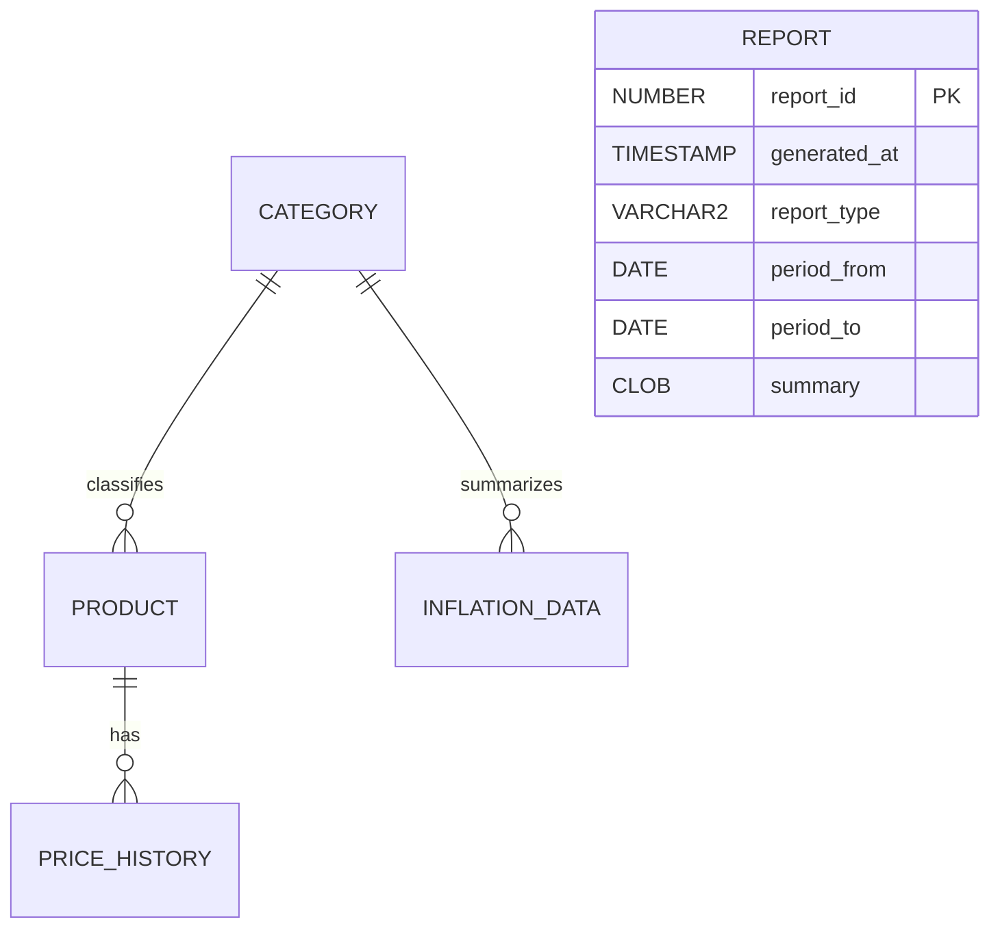

# Inflation Impact Analyser: Oracle demonstration

This component implements the team's five-entity ER diagram using Oracle SQL and
PL/SQL. It is independently demonstrable in SQL*Plus. The existing React frontend
is preserved and still uses its original in-memory fixtures. There is no backend
or live browser/database connection in this submission component.

## Prerequisites and safety

- Tested target: Oracle Database XE 21c, PDB `XEPDB1`, SQL*Plus 21c on Windows.
- Main schema scripts use Oracle 12c+ identity columns; each identity has an
  Oracle-managed sequence. The optional administrator provisioning script uses
  Oracle 18c+ `NO AUTHENTICATION` syntax. No separate application sequences or
  ID-generating triggers are needed.
- Use a dedicated application account with CREATE SESSION, CREATE TABLE, CREATE
  VIEW, CREATE PROCEDURE, CREATE TRIGGER, CREATE SEQUENCE and a tablespace quota.
- Do not run the main scripts as SYS, SYSTEM or PDBADMIN. Preflight rejects them.
- Do not run setup over existing project objects: preflight rejects collisions.
  No script drops/truncates tables or resets existing data. DDL implicitly commits;
  a partial installation must be inspected, not blindly rerun.
- Scripts contain no credentials. Do not place credentials in Git, screenshots,
  shell command arguments, SQL spools, or React/VITE environment variables.

## Connection and exact execution order

In PowerShell (use your installed SQL*Plus path if needed):

```powershell
& 'C:\app\aaron\product\21c\dbhomeXE\bin\sqlplus.exe' /nolog
```

In SQL*Plus, connect with your account and actual service; the password is prompted:

```sql
CONNECT iia_project@//localhost:1521/XEPDB1
SHOW USER
SELECT SYS_CONTEXT('USERENV','CON_NAME') FROM dual;
@"D:\Projects\inflation-analyser\database\oracle\run_all.sql"
```

`run_all.sql` executes these scripts in order using `@@` (relative to the runner):

1. `00_preflight.sql`: identity, privilege and name-collision checks; quota display.
2. `01_tables.sql`: five tables, constraints, identity generators and supporting index.
3. `02_views.sql`: latest prices, consecutive price changes and category coverage.
4. `03_plsql.sql`: function, three procedures and unit-preservation trigger.
5. `04_demo_data.sql`: synthetic fixtures for every entity; explicit COMMIT.
6. `05_reports.sql`: eight demonstrations of queries and reporting.
7. `06_tests.sql`: positive and negative tests; test DML rolled back.
8. `07_verify.sql`: object validity, constraints, counts and orphan checks.

For an already installed demo, **do not rerun run_all.sql**. Reconnect and run:

```sql
WHENEVER OSERROR EXIT FAILURE ROLLBACK
WHENEVER SQLERROR EXIT FAILURE ROLLBACK
SET SERVEROUTPUT ON
SPOOL submission-demo.log
@"D:\Projects\inflation-analyser\database\oracle\05_reports.sql"
@"D:\Projects\inflation-analyser\database\oracle\06_tests.sql"
@"D:\Projects\inflation-analyser\database\oracle\07_verify.sql"
SPOOL OFF
```

All 27 assertions should report PASS, followed by ALL TESTS PASSED. Expected final
counts: CATEGORY=4, PRODUCT=6, PRICE_HISTORY=108, INFLATION_DATA=4, REPORT=1.
Counts/assertions are for the unmodified demonstration dataset, not arbitrary real
data. SQL*Plus exits on unexpected SQL/PLSQL or OS errors; inspect the spool for
SP2 command errors too. A PL/SQL compilation warning may not raise a SQL error:
`SHOW ERRORS` and the final `USER_ERRORS`/object-status checks cover that case.

### If you do not yet have an application user

An authorized DBA can connect to the intended PDB and run `admin_create_user.sql`.
For the verified local XE installation, OS-authenticated administration was available:

```sql
CONNECT / AS SYSDBA
ALTER SESSION SET CONTAINER=XEPDB1;
@"D:\Projects\inflation-analyser\database\oracle\admin_create_user.sql"
```

This creates only `IIA_PROJECT`, with limited object-creation permissions and a 20 MB
USERS quota. SQL*Plus `PASSWORD` prompts privately. If the user exists, stop and
inspect it; do not delete it. Reconnect as the application user before setup.

The tested local demo account is documented in `TEST_RESULTS.md`. Its test password
was generated privately and is not stored in this repository. An authorized local
DBA must use `PASSWORD IIA_DEMO_20261020` (or the fresh-run account documented there)
inside XEPDB1 to choose a private demo password before connecting interactively.

## Data dictionary and relationships

The entity/attribute set is unchanged. PK means primary key; FK means foreign key.
All IDs are NUMBER GENERATED ALWAYS AS IDENTITY primary keys. IDs are not assumed
to be contiguous; failed inserts and rolled-back tests consume identity values.

| Entity | Other attributes and rules |
|---|---|
| CATEGORY | category_name VARCHAR2(60), required, unique, trimmed/nonblank; description VARCHAR2(500), optional |
| PRODUCT | category_id NUMBER required FK; product_name VARCHAR2(100), unit VARCHAR2(40), brand VARCHAR2(100) required/nonblank; brand defaults Generic; active_status CHAR(1) Y/N, defaults Y; unique category/name/unit/brand |
| PRICE_HISTORY | product_id NUMBER required FK; observed_date DATE required/calendar midnight; price NUMBER(12,2) required/>0; source VARCHAR2(200) required/nonblank; location VARCHAR2(100) required/trimmed/nonblank; unique product/location/date |
| INFLATION_DATA | category_id NUMBER required FK; period_start/period_end DATE required/calendar midnight, end>start; inflation_rate NUMBER(12,4) required/>-100; unique category/start/end |
| REPORT | generated_at TIMESTAMP required/default SYSTIMESTAMP; report_type VARCHAR2(30) required and limited to PRICE_SUMMARY/CATEGORY_INFLATION; period_from/period_to DATE required/calendar midnight, to>=from; summary CLOB required |



REPORT is an independent historical snapshot: the approved attributes contain no
category_id/product_id, so no relationship was invented. INFLATION_DATA is a stored
derived summary: refresh it after changing observations for that period. REPORT
snapshots intentionally remain unchanged when underlying prices change.

Category/product facts are separated from repeated observations (3NF-style design).
Location and source remain text because the approved design has exactly five
entities. Consequently spelling/case must be standardized at entry; there is no
location master table. All Goods is a UI filter, not a CATEGORY row.

## Explicit assumptions and defensible analytics

- Currency is INR. A product definition represents one fixed unit and generic
  brand unless another brand is explicitly supplied. Electricity is interpreted
  as 1 kWh in the database fixture; the existing UI's `1 unit` label is unchanged.
- One representative price per product/city/calendar day. Source is provenance,
  not another price-series dimension. Multiple retailer quotes require a future,
  explicitly approved model change.
- Data is synthetic: original nine frontend values are assigned invented monthly
  dates January 1 through September 1, 2026 in Bengaluru. Chennai uses 1.05 times
  each price rounded to two decimals. Other frontend cities have no database
  observations. No claims about real city prices are made.
- Price change = 100 * (end_price-start_price)/start_price for the SAME product,
  unit and location. Positive base prices avoid division by zero.
- `fn_price_change` requires exact endpoint dates; missing either returns NULL.
  It does not interpolate. `v_price_changes` compares consecutive available
  observations and exposes both dates; row offsets are not calendar periods.
- Category inflation is the unweighted arithmetic mean of each comparable
  product/location series' unrounded percentage change at the exact endpoints.
  Missing pairs are excluded; report 7 displays the count. No comparable pairs
  raises an error. Each observed location-series has equal weight; products with
  more locations therefore contribute more series. This is deliberate and must
  be disclosed, not described as a household expenditure-weighted measure.
- These product/category measures are **not official weighted CPI inflation**.
  Raw prices with different units are never averaged together into an index.
- Deactivated products keep historical observations. `pr_record_price` prevents
  adding prices to inactive products; direct SQL can bypass that procedural rule,
  so application writes should use the procedure. Constraints apply to all writes.

## PL/SQL demonstration

`fn_price_change(product_id,location,from_date,to_date)` returns a percentage or
NULL for missing endpoints. `pr_record_price` validates active status and inserts
an observation. `pr_refresh_inflation` inserts/updates a category period measure.
`pr_generate_report` stores an inclusive date-range coverage summary and returns
its ID. Procedures deliberately do not COMMIT; the caller controls transactions.

`trg_product_unit_lock` prevents changing a product's unit after it has history,
avoiding invalid comparisons across units. It queries PRICE_HISTORY, not its own
mutating PRODUCT table. No extra audit entity or redundant ID trigger is added.

Example using ID lookup rather than assuming generated IDs:

```sql
SELECT product_name,
       fn_price_change(product_id,'Bengaluru',DATE '2026-06-01',DATE '2026-09-01') pct
FROM product WHERE product_name='Rice';

VARIABLE report_id NUMBER
EXEC pr_generate_report(DATE '2026-01-01',DATE '2026-09-01',:report_id);
PRINT report_id
ROLLBACK;
```

The report insert is rolled back here so the demo still has one stored report.

## Troubleshooting

| Error | Action |
|---|---|
| ORA-01017 / ORA-28000 | Confirm the correct application account/password/PDB, or ask the DBA about account status; do not publish credentials |
| ORA-12154 | Check connection alias resolution; use the confirmed host/port/service |
| ORA-12514 / ORA-12541 | Check registered service/listener availability with the DBA; do not reset database configuration |
| ORA-01031 / ORA-01950 | Ask the DBA for the listed privileges or application tablespace quota |
| ORA-00955 / -20002 | Objects exist; inspect and use reports/verification rather than rerunning setup |
| ORA-00942 | Check application user, table creation order and prior errors |
| ORA-00001 | Duplicate category/product definition or product/location/date |
| ORA-02291 / ORA-02292 | Missing parent or protected referenced parent; preserve relationships |
| ORA-02290 / ORA-01400 | Check required values and named CHECK constraint |
| ORA-01861 | Use DATE 'YYYY-MM-DD' literals or explicit format conversions |
| ORA-20010 through -20014 | Application validation: read message, correct dates/endpoint coverage/active status/unit |
| ORA-04063 / PLS errors | SHOW ERRORS, then SELECT * FROM user_errors; fix source before continuing |
| SP2-0310 | Check script path; use quoted absolute runner path; nested @@ paths are relative |

Terminate ordinary SQL with `;`. Finish PL/SQL blocks with `/` on its own line.
Do not add `/` after an already executed INSERT: it executes the buffer again.

## Minimal integration and submission scope

The current React UI needs no changes for a SQL*Plus DBMS demonstration. It remains
an independent prototype: do not claim it loads Oracle data. Database-backed UI
would require a server-side API/Oracle driver, connection pool and credentials
kept outside Git. Proposed read-only endpoints: locations, categories, latest
prices filtered by city/category/search, and dated product history. Use bind
variables, server-side validation and a SELECT-only runtime account. The backend
can query V_LATEST_PRICES and PRICE_HISTORY; browser code must never call SQL*Plus
or connect directly to Oracle. This is documented future work, not a working API.

## Evaluation checklist

- [x] Exactly five approved entities and all specified attributes.
- [x] PK/FK/UNIQUE/NOT NULL/CHECK constraints and generated IDs.
- [x] Relationships, normalization choices and independent REPORT explained.
- [x] Synthetic rows in every table with provenance and explicit dates.
- [x] Joins, filters, GROUP BY/HAVING, aggregates, correlated subquery.
- [x] Views and analytic ROW_NUMBER/LAG functions.
- [x] PL/SQL function, procedures, exception handling and justified trigger.
- [x] Constraint/relationship/business-rule tests with rolled-back test data.
- [x] Compilation checks, object inventory, expected counts and SQL*Plus guide.
- [ ] Browser/API integration (outside the implemented SQL*Plus demo).

Official references: [SQL*Plus error handling](https://docs.oracle.com/en/database/oracle/oracle-database/21/sqpug/WHENEVER-SQLERROR.html),
[implicit DDL commits](https://docs.oracle.com/en/database/oracle/oracle-database/19/tdddg/data-definition-language-ddl-statements.html).
